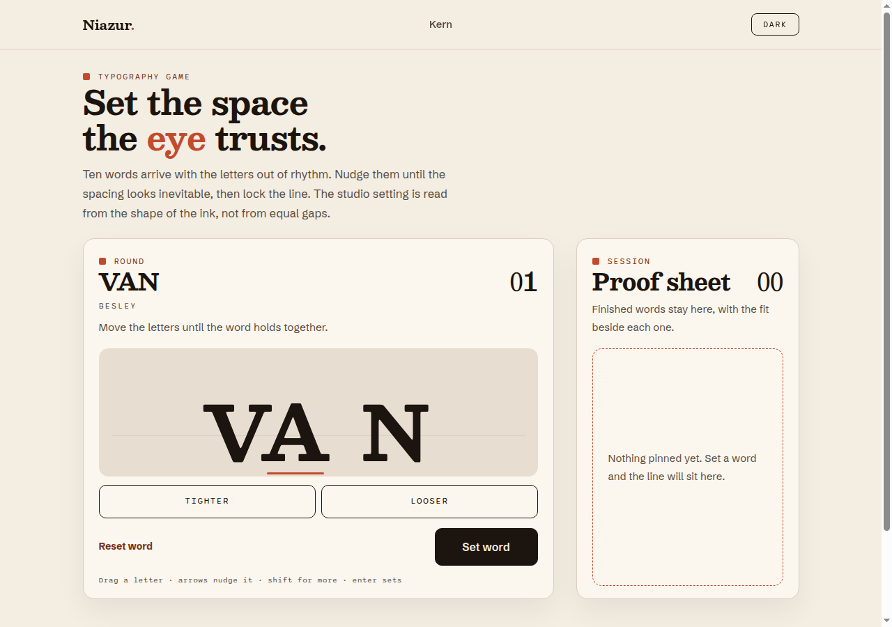
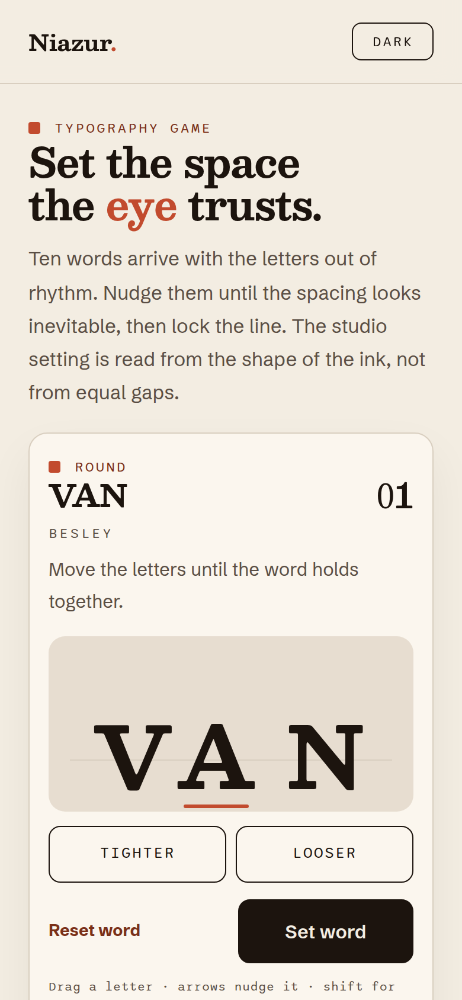
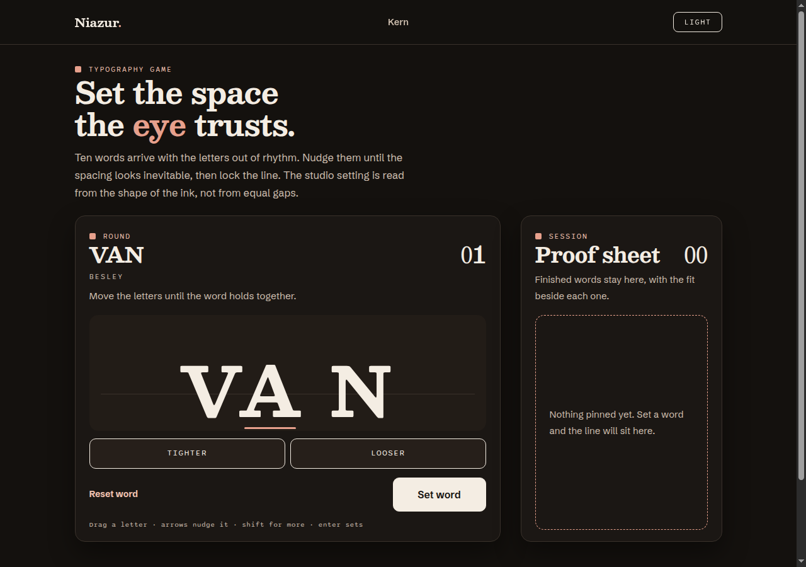

# Kern

A small game about kerning. Ten words arrive with the letters out of rhythm. You set them by eye, then see your line against a studio setting read from the shape of the ink.

**Live:** https://niaz507.github.io/kern-game/





Night, on the same paper and madder:



## The idea

Kerning is the work of making the space between letters look even, which is not the same as making the gaps equal. Diagonals want to nest, a round meets its neighbour at the equator, and a serif spur should not hold a pair open.

Each round hands you one word in a different display face, spaced badly on purpose. Drag the letters until the word holds together, then lock the line. Your setting stays in ink. The studio setting appears in red, registered to the same first letter, so the disagreement is visible. The fit is how close your pairs are to that red line. Ten rounds, then a proof: a score out of 1000, a rank, and a line you can copy. The best total is kept in the browser.

The studio setting is computed, not guessed. For each pair, the right edge of one glyph and the left edge of the next are read row by row. A short band just inside the closest rows is set a fixed distance apart. That distance, and a few other knobs, are chosen per face. The arithmetic lives in `kern.js`, with no DOM, so the page and the tests share it.

[Designed by Niazur Rahman](https://www.niazur.me)

## How to play

Select a letter and move it. The first letter is the anchor. Everything after a letter travels with it, which is how a kerning pair actually works: you open or close the space before the letter you are holding.

| | |
| --- | --- |
| Drag | Move a letter. Touch works the same way. |
| Tighter / Looser | The same nudge, with a large target. |
| Left / Right | Nudge the selected letter. Shift is a larger step. |
| Up / Down | Move to the previous or next letter. |
| Enter | Lock the line. |
| Reset word | Return this word to the spacing it arrived with. |

After you lock the line, the note names the pair that is still the furthest from the studio. Next word continues. At the end, Copy puts the result on the clipboard, for example `Kern 864/1000 · Compositor`.

| Average | Rank |
| --- | --- |
| 92 and up | Master proof |
| 80 | Compositor |
| 65 | Steady hand |
| 45 | Loose fit |
| Below that | Open case |

Light and dark follow the system on the first visit. The choice is remembered. The best score is remembered too.

## Type and colour

The chrome is not the usual web trio, and it is not the green-and-Syne system of the studio site. A kerning game should look like a proof pulled from a foundry: a poster face, a newspaper text face, and a mark for the small type.

| Role | Face | Why |
| --- | --- | --- |
| Display | [Besley](https://fonts.google.com/specimen/Besley) | A Clarendon revival by Owen Earl. Ball terminals, a heavy slab, the colour of a printed poster. It is almost never the default for an interface, which is the point. |
| Text | [Schibsted Grotesk](https://fonts.google.com/specimen/Schibsted+Grotesk) | Drawn for a newspaper group. It stays readable at 16px and does not read as Inter, Roboto, or another geometric sans. |
| Labels | [Sono](https://fonts.google.com/specimen/Sono) | Tyler Finck’s soft monospace. The specimen names, the round index, and the share line sit in it. It looks like a composing-room note, not a code editor. |

All three are free under the Open Font License, loaded from Google Fonts. Besley is used at 700, Schibsted Grotesk at 400–700, Sono at 400–600.

The ten words are set in other faces, on purpose, so the eye has to retune: Besley, Fraunces, Bodoni Moda, Newsreader, Unbounded, Cormorant Garamond, Big Shoulders Display, Literata, Familjen Grotesk, and Gloock. They are specimens, not the interface.

The palette is a proofing sheet. Warm paper, walnut ink, and madder — the red a printer uses to mark a correction. No blue, and no purple or teal gradient.

| Token | Light | Dark | Use |
| --- | --- | --- | --- |
| Paper | `#F3EDE2` | `#14110E` | Page |
| Surface | `#E7DDD0` | `#221C17` | The composing stick, the footer |
| Card | `#FBF6EE` | `#1B1714` | Panels |
| Ink | `#1C140E` | `#F4EDE3` | Text, the lock-up button |
| Muted | `#5A4E44` | `#CDBEAE` | Secondary copy |
| Madder | `#C24B2E` | `#E7A08C` | The accent word, the studio setting, focus |
| Madder ink | `#7A3018` | `#F0C2B0` | Small red text: labels, links, a high score |

Madder at `#C24B2E` is about 4.2:1 on the paper, which is enough for the large accent word and short of 4.5:1 for small type, so labels and links use `#7A3018` (about 8:1). Ink on paper is about 15.6:1. At night the same pairing is turned over: paper becomes the text, and the small red lifts to `#F0C2B0` so it stays above 10:1. Focus is a 2px ring, 2px outside the control. `prefers-reduced-motion` collapses animation, as a proof sheet should sit still when asked.

## Run it

`index.html` is at the repository root. Open that file, or serve the folder. There is no build step, which is what GitHub Pages needs:

```bash
python3 -m http.server
```

The live link above works once GitHub Pages is set to deploy from the `main` branch, root directory.

## Tests

```bash
node test/kern.test.js
```

`npm test` runs the same script. It covers the optical fit, the score, the ranks, and the scramble, without a browser.

## License

[MIT](LICENSE). Copyright 2026 Niazur Rahman.
